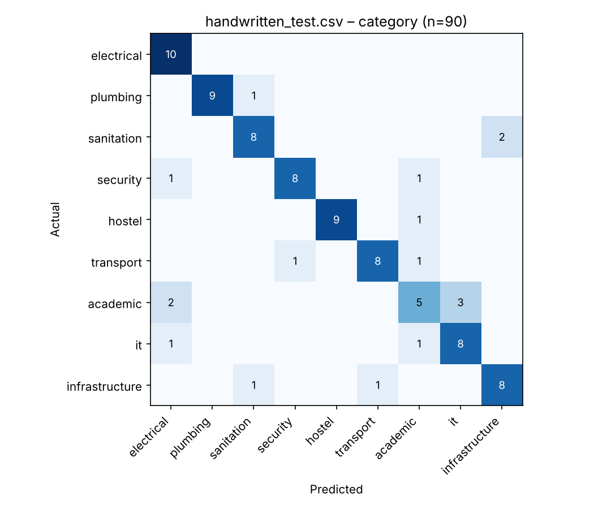

# CampusCare AI – evaluation

Classifier: `tfidf-logreg-v1` · Embedder: `lsa-tfidf-128` · Average analysis time: 4.0 ms per report

## Classification and triage

| Test set | n | Category accuracy | Macro-F1 | Severity within ±1 | Severity MAE | Urgency within ±1 | Safety recall | Safety precision | Critical reports flagged (sev ≥ 4) |
|---|---|---|---|---|---|---|---|---|---|
| Held-out phrasings (generated) | 908 | 77.9% | 0.778 | 97.8% | 0.41 | 97.6% | 65.9% | 85.7% | 79.0% |
| Development set: model only | 162 | 95.1% | 0.950 | 100.0% | 0.20 | 98.2% | 79.6% | 93.5% | 100.0% |
| Development set: model + safety rules | 162 | 95.1% | 0.950 | 98.8% | 0.18 | 98.2% | 85.2% | 93.9% | 100.0% |
| Development set: keyword engine (backend built-in) | 162 | 66.0% | 0.659 | 79.6% | 0.81 | 80.9% | 27.8% | 100.0% | 46.2% |
| Test set: model only | 90 | 81.1% | 0.811 | 93.3% | 0.58 | 92.2% | 64.3% | 66.7% | 62.5% |
| Test set: model + safety rules | 90 | 81.1% | 0.811 | 94.4% | 0.54 | 92.2% | 71.4% | 69.0% | 75.0% |
| Test set: keyword engine (backend built-in) | 90 | 73.3% | 0.728 | 77.8% | 0.87 | 82.2% | 25.0% | 87.5% | 50.0% |

## Per category (test set, production model)

| Category | Precision | Recall | F1 | n |
|---|---|---|---|---|
| electrical | 0.71 | 1.00 | 0.83 | 10 |
| plumbing | 1.00 | 0.90 | 0.95 | 10 |
| sanitation | 0.80 | 0.80 | 0.80 | 10 |
| security | 0.89 | 0.80 | 0.84 | 10 |
| hostel | 1.00 | 0.90 | 0.95 | 10 |
| transport | 0.89 | 0.80 | 0.84 | 10 |
| academic | 0.56 | 0.50 | 0.53 | 10 |
| it | 0.73 | 0.80 | 0.76 | 10 |
| infrastructure | 0.80 | 0.80 | 0.80 | 10 |

## Duplicate detection (text similarity only)

| Method | ROC AUC | Mean: duplicates | Mean: same category, different issue | Mean: different category | Best threshold | Accuracy at best |
|---|---|---|---|---|---|---|
| Word overlap (backend fallback) | 0.815 | 0.49 | 0.18 | 0.34 | 0.50 | 75.0% |
| lsa-tfidf-128 | 0.877 | 0.67 | 0.25 | 0.38 | 0.40 | 80.0% |

## How to read this

- **Held-out phrasings**: generated sentences whose wording was never seen in training. Shows the model learned the categories, not the sentences.
- **Development set** (`data/handwritten_dev.csv`, 162 hand-written complaints): used once for error analysis, which led to adding missing vocabulary and risk phrases to the generator. Its scores are therefore slightly optimistic.
- **Test set** (`data/handwritten_test.csv`, 90 hand-written complaints): written before that change and never used for any decision. This is the number to quote.
- **Safety rules** only raise scores. Compare the *model only* and *model + safety rules* rows to see what they add.
- **Keyword engine** is the rule-based triage built into the backend, used when this service is not running.
- **Duplicate detection**: in the backend the final score also adds 0.15 for the same place and 0.10 for the same category; 0.62 counts as a likely duplicate.
- All hand-written sets were written by the developers, not collected from students. Retrain with real exported reports once the system is in use.
